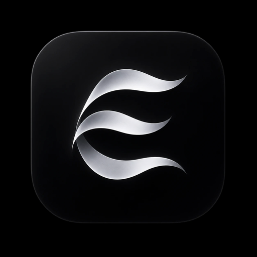
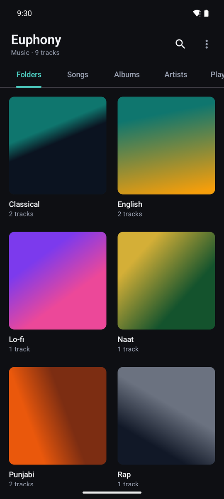
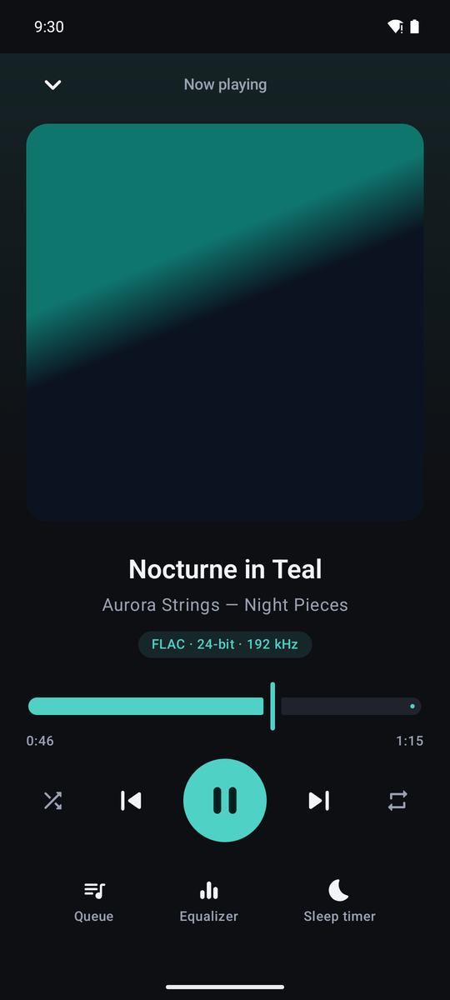
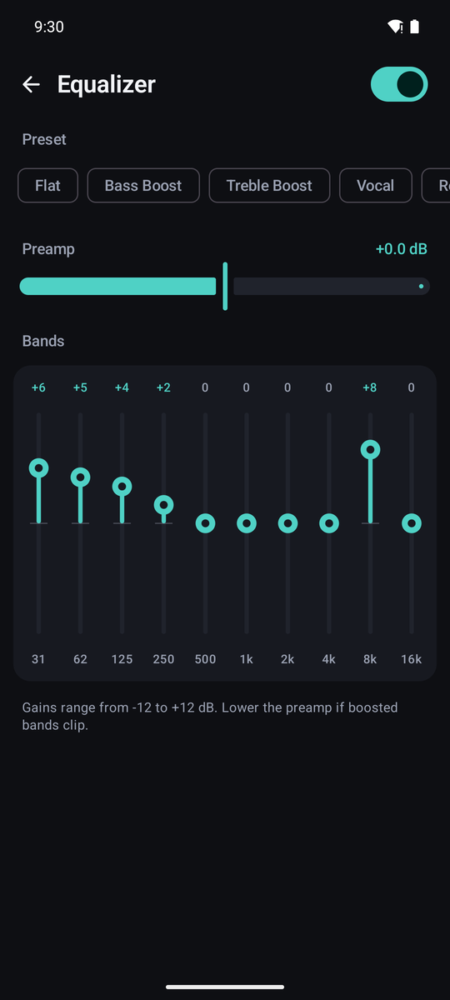
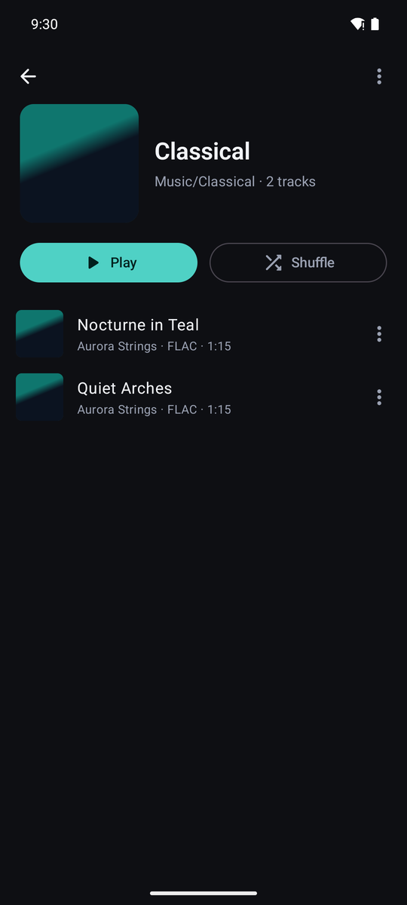
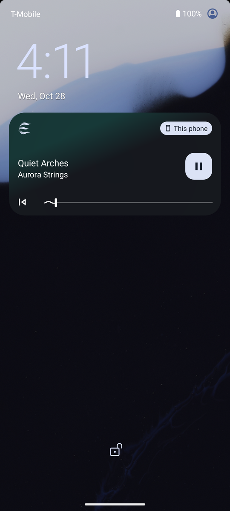
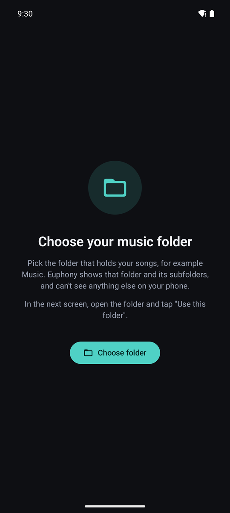

<div align="center">



# Euphony

**A clean, offline music player for Android, built for FLAC and hi-res lossless audio.**

No ads · No accounts · No internet permission · Android 10+

<a href="../../releases/latest"><b>⬇ Download the latest APK</b></a>

</div>

<table>
  <tr>
    <td align="center"><br><sub>Your folders, as cards</sub></td>
    <td align="center"><br><sub>24-bit / 192 kHz FLAC</sub></td>
    <td align="center"><br><sub>10-band equalizer</sub></td>
  </tr>
  <tr>
    <td align="center"><br><sub>One tap to Play or Shuffle</sub></td>
    <td align="center"><br><sub>Lock-screen controls</sub></td>
    <td align="center"><br><sub>Sees only the folder you pick</sub></td>
  </tr>
</table>

<sub>Screenshots use generated demo tracks and artwork.</sub>

## Hi-res lossless audio

Euphony is built around lossless playback. It keeps your music at full quality all the way to Android's audio system:

- **FLAC at any common resolution:** 16-bit and 24-bit, from 44.1 kHz up to **192 kHz** (tested with 24-bit / 192 kHz files).
- **No downgrade inside the app.** 24-bit audio is decoded to 32-bit float and handed to Android at its original sample rate. The app never cuts it to 16-bit or resamples it.
- **Real format label.** Now playing shows what is actually being decoded, for example `FLAC · 24-bit · 192 kHz`, so you can confirm you're hearing the hi-res file.
- **Efficient.** FLAC is decoded by the phone's built-in decoder, which uses less battery than a bundled software decoder.
- **Other formats too:** WAV, MP3, AAC (M4A), Opus and Ogg Vorbis.

> **About your phone's output:** after the app, Android mixes audio at the rate your hardware supports. Many phones output 48 kHz through their speaker or headphone jack; hi-res-capable phones and USB DACs can output more. Euphony always delivers the full-resolution signal; the final step depends on the device.

## Easy to use

- **Folders first.** Pick your music folder once. Each subfolder (English, Naat, Punjabi, Rap…) appears as a card with its cover art, so your library looks the way you organised it.
- **One tap to play.** Every folder, album, artist and playlist has big **Play** and **Shuffle** buttons. Tap any song to start from there.
- **Mini player** at the bottom of every list. Tap it for the full **Now playing** screen with large artwork, a seek bar, and shuffle and repeat.
- **Long lists made simple:** search, plus tabs for Songs, Albums, Artists and Playlists.
- **Song menu:** Play next, Add to queue, Add to playlist.
- **Queue** you can reorder, and **playlists** you can create, rename, reorder and delete.
- **10-band equalizer** (31 Hz – 16 kHz, ±12 dB) with presets and a preamp.
- **Sleep timer** (15–90 minutes) with a live countdown.
- **Controls everywhere:** notification, lock screen and headset buttons. Music keeps playing in the background.
- **Open with Euphony** from any file manager to play a single audio file.

## Private by design

- **Only your folder.** Euphony has no storage permission. It reads the one folder you choose through Android's folder picker, and nothing else on your phone.
- **Fully offline.** There's no INTERNET permission, so nothing ever leaves the device.
- **No accounts, ads or tracking.**

## Install

1. Download **Euphony-release.apk** from the [latest release](../../releases/latest).
2. Open it on your phone. If Android asks, allow your browser or file manager to **install unknown apps**, then tap **Install**.
3. Open Euphony, allow notifications (for the lock-screen controls), tap **Choose folder**, open your music folder and tap **Use this folder**.

With a computer and USB debugging, you can also run `adb install Euphony-release.apk`.

**Tips:**
- Add songs by copying them into your folder. They appear the next time you open the app, or straight away with ⋮ → **Rescan folder**.
- Switch folders with ⋮ → **Change folder**.
- Songs without tags are listed by file name, with their folder used as the album name.

## Build from source

| | |
|---|---|
| Phone | Android 10 (API 29) or newer |
| JDK | 17 or newer (built with JDK 25) |
| Android SDK | Platform 37 (`ANDROID_HOME` pointing at the SDK) |
| Gradle | Included wrapper (Gradle 9.8.2) |

```bat
set JAVA_HOME=C:\Program Files\Java\jdk-25
set ANDROID_HOME=%LOCALAPPDATA%\Android\Sdk

gradlew.bat :app:assembleRelease
gradlew.bat :app:testDebugUnitTest
```

On macOS or Linux, use `./gradlew`. The APK is written to `app/build/outputs/apk/release/Euphony-release.apk`, minified with R8 and signed with your local debug key so it installs directly. To publish under your own key, replace `signingConfigs.getByName("debug")` in `app/build.gradle.kts`.

**Tech:** Kotlin, Jetpack Compose (Material 3), Media3 ExoPlayer with `MediaSessionService`, and the Storage Access Framework. The toolchain is AGP 9.4.1 with Kotlin 2.4.21.

## Project structure

```
app/src/main/java/com/euphony/player/
├── EuphonyApp.kt            Application; AppGraph holds the app-wide singletons
├── MainActivity.kt          Edge-to-edge host, folder picker, notification permission, "Open with" intents
├── model/Contracts.kt       Shared data types and interfaces
├── data/
│   ├── LibraryRepository.kt Walks the chosen folder (Storage Access Framework), reads tags, caches them
│   ├── FolderScan.kt        Audio detection, stable ids, tag parsing
│   ├── LibraryGrouping.kt   Builds albums / artists / folders from tracks
│   └── PlaylistStore.kt     Playlists as JSON in app storage
├── playback/
│   ├── PlaybackService.kt   Media3 MediaSessionService + ExoPlayer (float output for hi-res), sleep timer
│   ├── PlayerConnection.kt  UI-side MediaController exposing playback state
│   ├── EqualizerController.kt / EqMath.kt   10-band EQ
│   └── FormatLabel.kt       "FLAC · 24-bit · 192 kHz" labels
└── ui/                      Compose screens: library, folders, now playing, queue, equalizer, dialogs
app/src/test/                Unit tests (folder scan, grouping, playlists, EQ math, format labels)
docs/                        Logo and screenshots
```
